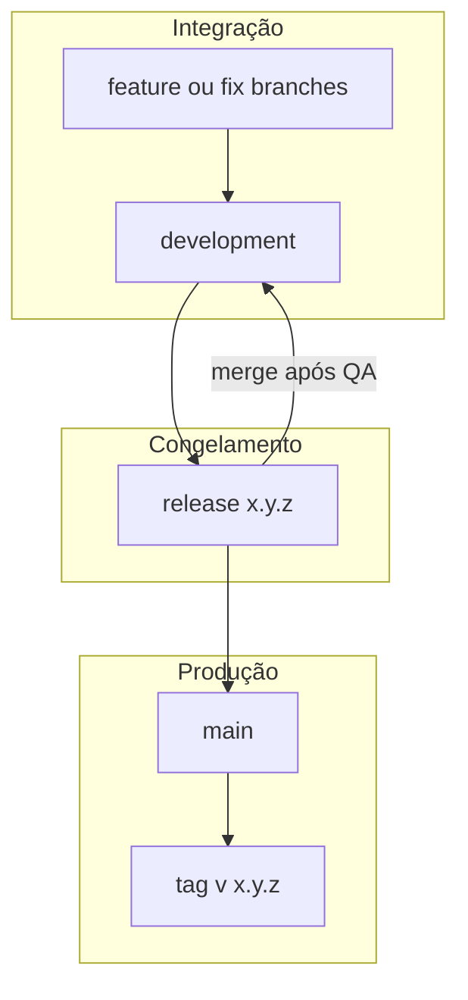
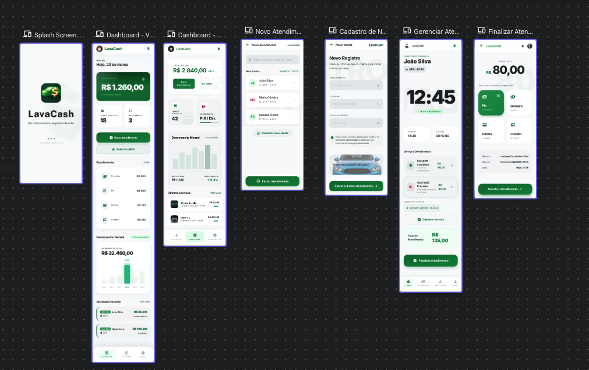

# LavaCash

App Flutter para operação de lavagem de veículos: cadastro, atendimento com serviços e pagamento, **dashboard** com visão do dia e **relatórios** diário e mensal (incluindo desempenho por semana do mês e melhor dia da semana). Backend **Supabase**; arquitetura **feature-first** com camadas *domain* → *data* → *presentation*, **GetX** e **Either** (dartz).

**Identidade visual:** tipografia **Inter**, verde principal **#006B2C** — ver [`lib/app/theme/app_colors.dart`](lib/app/theme/app_colors.dart).

**SDK:** Dart `>=3.7.0 <4.0.0` (ver `pubspec.yaml`).

**Guia de arquitetura (referência interna):** [`.agents/skills/flutter-architecting-apps/SKILL.md`](.agents/skills/flutter-architecting-apps/SKILL.md) — princípios, árvore por feature, camada de dados (repositórios, adapters) e fluxo de implementação.

---

## Princípios de arquitetura

Alinhado ao skill acima:

| Princípio | Aplicação no projeto |
|-----------|----------------------|
| **Separação de responsabilidades** | UI só apresentação; regras e I/O em domain/data. |
| **Single source of truth** | Repositórios como fronteira de dados; Supabase atrás de implementações em `features/*/data/`. |
| **Fluxo unidirecional** | Eventos sobem da UI; estado desce via controllers e entidades. |
| **UI como função de estado** | Controllers GetX + `Obx` / reatividade onde faz sentido. |

### Organização por feature (`lib/features/<feature>/`)

Cada feature agrupa as camadas que precisa:

```
features/<nome>/
  data/
    adapters/        # Mapeamento RPC/JSON → entidades (opcional, quando o payload não bate com select aninhado)
    repositories/    # Implementações Supabase
  domain/
    repositories/    # Contratos
    usecases/        # Casos de uso quando a lógica merece isolamento
  presentation/
    controllers/     # GetX Controllers
    pages/
    widgets/
```

Código **compartilhado:** `lib/core/` (erros, rede, utilitários, widgets genéricos). Entidades globais reutilizáveis: `lib/domain/entities/` e modelos DTO em `lib/data/models/` quando aplicável.

**Regra de dependência:** *presentation* → *domain* ← *data*. O domínio não importa Flutter nem Supabase.

---

## Stack

| Camada | Tecnologia |
|--------|------------|
| UI | Flutter (Material), `fl_chart` para gráficos |
| Estado / rotas | GetX (`Controller`, `Binding`, `GetPage`) |
| Backend | Supabase (Postgres + RPC) |
| Erros | `Either<Failure, T>` (dartz); falhas em [`lib/core/error/failures.dart`](lib/core/error/failures.dart) |
| Datas / locale | `intl`, formatação `pt_BR` |

---

## Branching e GitFlow

| Branch | Papel |
|--------|--------|
| **`main`** | Produção; recebe merge de `release/*` (ou `hotfix/*`); **tags `v*`** marcam releases publicados. |
| **`development`** | Integração contínua do dia a dia. |
| **`release/x.y.z`** | Congelamento (ex.: `release/1.1.0`); após QA, merge em **`main`**, tag **`vx.y.z`**, depois merge de volta para `development` se necessário. |



Hotfix opcional: `hotfix/*` a partir de `main` → merge em `main` e em `development`.

### Release Android (GitHub Actions)

O workflow [`.github/workflows/release-android.yml`](.github/workflows/release-android.yml) **não** roda em push para `development` ou `main`. Só dispara:

1. **`workflow_dispatch`** (ação manual no GitHub) — inputs: `is_mandatory`, `release_notes` opcional, `apk_storage_path` (default `lavacash/latest.apk`).
2. **`push` de tags `v*`** — o job verifica se o commit do tag está na história de `main`; `is_mandatory` usa **false** por omissão (sem inputs).

**Secrets do repositório** (Settings → Secrets and variables → Actions):

| Secret | Uso |
|--------|-----|
| `SUPABASE_URL` | URL do projeto (mesma da API). |
| `SUPABASE_SERVICE_ROLE_KEY` | Upload no Storage `app-releases` + `PATCH` em `public.app_version` (nunca no app cliente). |
| `DART_DEFINES_JSON` | JSON com os `--dart-define` necessários para o build (mesmo conteúdo lógico que `dart_defines.json` local: `SUPABASE_*`, `LICENSE_SUPABASE_*`, `LICENSE_LOCAL_CACHE_*`, etc.). |

**Erro `Unable to parse file provided for --dart-define-from-file` / `Invalid property line` / `Extra data`:** o secret tem de ser **um único objeto JSON** — sem cercas ` ``` `, sem comentários, sem vírgula extra no último campo, **sem colar o JSON duas vezes** nem texto depois do `}` final. No terminal: `jq -c . dart_defines.json` e cola **só essa linha** no secret. O erro `Extra data: line 1 column …` costuma ser **dois JSON seguidos** ou caracteres a mais após o primeiro `}`.

O pipeline **substitui** o objeto do APK no path configurado e **atualiza a linha** `app_version` (metadados de versão). **Não** apaga tabelas de negócio nem outros buckets. O build replica [`scripts/build_release.sh`](scripts/build_release.sh) (`--split-per-abi`, obfuscação, `--tree-shake-icons`); o upload publica o APK **arm64-v8a** (`app-arm64-v8a-release.apk`) no `apk_storage_path` (ex.: `lavacash/latest.apk`).

### Verificação após rodar o workflow

No Supabase (SQL Editor ou MCP `execute_sql`):

```sql
SELECT latest_version, latest_build_number, apk_storage_path, is_mandatory
FROM public.app_version
WHERE id = 1;
```

Em dispositivo com build antigo, confirmar o dialog de atualização conforme `is_mandatory`.

---

## Bootstrap (`main.dart`)

Inicialização assíncrona roda dentro de **`runZonedGuarded`**, com **`WidgetsFlutterBinding.ensureInitialized()`** na mesma zona que **`runApp`** (evita *zone mismatch* do Flutter). Ordem: `ensureInitialized` → `initializeDateFormatting('pt_BR')` → Supabase → orientação retrato → `AppGlobalController` → `runApp`.

---

## Visão geral do produto

1. **Splash** — checagem de licença por dispositivo antes de entrar no app.
2. **Home** — duas áreas principais:
   - **Dashboard** — resumo do dia (total, carros, em andamento), recebimento por forma de pagamento, atalhos para novo atendimento e relatório diário, e seção de **desempenho mensal** (semanas do mês + tendência).
   - **Relatórios** — sub-abas **Diário** e **Mensal**: métricas detalhadas, lista de meses com destaque e crescimento vs. mês anterior, **melhor dia da semana** no mês, e performance semanal (`get_weekly_report` / `get_best_weekday_report` no Supabase).
3. **Barra inferior** — **Relatórios** | **Dashboard** | **Novo** (abre **Novo atendimento**: busca por placa/nome, clientes recentes e fluxo para atendimento).
4. **Busca** — `VehicleSearchController` + repositório em `features/search`; busca normalizada (case e acentos) via RPC `search_vehicles_normalized`; UI principal em **Novo atendimento**; no relatório diário, lista ampliada via **VER TODOS** ao lado de “Atendimentos do dia”.
5. **Fluxo operacional** — cadastro (rota dedicada) → atendimento por veículo → pagamento (Pix, dinheiro, débito, crédito).
6. **Licença** — validação em projeto Supabase dedicado (ver `LICENSE_SUPABASE_*` e `features/license`); o banco principal do app não guarda mais `licencas` / `activation_keys`.

---

## Referência de telas (UI)

Fluxo e visão geral das principais superfícies:



| Área | Descrição |
|------|-----------|
| **Splash** | Marca LavaCash, sincronização inicial e validação de licença. |
| **Dashboard** | Hero do dia, estatísticas, recebimento, atalhos e performance mensal (semanas + link para relatório mensal). |
| **Relatórios → Diário** | Relatório do dia, formas de pagamento, atendimentos; busca ampliada via **VER TODOS**. |
| **Relatórios → Mensal** | Histórico de meses, crescimento, gráfico semanal, melhor dia da semana. |
| **Novo atendimento** | Busca, recentes e sequência serviço → pagamento; cadastro acessível a partir da mesma tela. |
| **Licença bloqueada** | Dispositivo sem licença ativa ou fluxo de ativação por chave (dados do aparelho + suporte). |

### Layout responsivo (métricas e valores)

- **Grid de duas colunas** para pares de cards (dashboard, relatório diário, relatório mensal): [`lib/features/reports/presentation/widgets/dashboard_stat_grid.dart`](lib/features/reports/presentation/widgets/dashboard_stat_grid.dart) — mesmo padrão de [`payment_method_grid.dart`](lib/features/payment/presentation/pages/widgets/payment_method_grid.dart) (`GridView.count`, `shrinkWrap`, `NeverScrollableScrollPhysics`, `childAspectRatio` ajustável).
- **Valores longos em pt_BR** (totais no hero e ticket médio nos cards): [`elite_hero_card.dart`](lib/shared/widgets/elite_hero_card.dart) e [`dashboard_stat_card.dart`](lib/features/reports/presentation/widgets/dashboard_stat_card.dart) usam `FittedBox` + `maxLines: 1` para o texto não quebrar no meio do número em telas estreitas.

---

## Funcionalidades

- **Licenciamento por dispositivo** — `features/license`; projeto Supabase de licenças separado; cache local criptografado após ativação.
- **Busca cliente/veículo** — `features/search`; debounce; adapter RPC em `data/adapters/`; uso em **Novo atendimento** e relatório diário.
- **Cadastro** — cliente + veículo (`features/registration`).
- **Serviço** — detalhes, total, status e timer; caso de uso `StartService` no binding (`features/service`).
- **Pagamento** — conclusão com método (`features/payment`).
- **Relatórios** — diário e mensal; agregações semanais e melhor dia da semana via RPC (`features/reports`).
- **Backend** — repositórios Supabase em `features/*/data/repositories`.
- **Core** — `core/utils`, `core/services` (ex.: ID do dispositivo, cache de recentes), widgets compartilhados.

---

## Arquitetura (resumo técnico)

- **Domain:** entidades em `lib/domain/entities/`, contratos de repositório e casos de uso por feature (`features/<feature>/domain/`).
- **Data:** `*RepositoryImpl` com Supabase; **adapters** em `features/<feature>/data/adapters/` para linhas RPC ou JSON heterogéneo; modelos em `lib/data/models/` quando aplicável.
- **Presentation:** páginas, `Controller` + `Binding` por rota ([`lib/app/routes/app_pages.dart`](lib/app/routes/app_pages.dart)).
- **Erros:** `Either` com `Failure`; tratamento nas camadas de dados e UI.
- **Núcleo:** `SupabaseInitializer`, tema (`app/theme`), widgets (`core/widgets`).

### Rotas nomeadas (GetX)

| Rota | Página |
|------|--------|
| `/splash` | Splash + licença |
| `/blocked` | Licença inativa / ativação |
| `/home` | Home (Dashboard + Relatórios) |
| `/registration` | Cadastro cliente/veículo |
| `/novo-atendimento` | Novo atendimento (busca + recentes) |
| `/in-progress-services` | Lista de atendimentos em andamento (filtro opcional via `arguments`) |
| `/service/:vehicleId` | Atendimento |
| `/payment/:serviceId` | Pagamento |

---

## Executar (com Supabase)

1. Copie `dart_defines.example.json` para `dart_defines.json` e preencha URL + anon key, ou use `.env` com `SUPABASE_URL` e `SUPABASE_ANON_KEY` (o app Flutter continua precisando de `dart_defines.json` ou `--dart-define`).
2. Rode:

```bash
flutter run --dart-define-from-file=dart_defines.json
```

Ou inline:

```bash
flutter run \
  --dart-define=SUPABASE_URL=https://YOUR_PROJECT.supabase.co \
  --dart-define=SUPABASE_ANON_KEY=YOUR_KEY
```

`dart_defines.json` e `.env` estão no `.gitignore`.

### Onde a URL do Supabase é lida

- **Código:** [`lib/core/network/supabase_initializer.dart`](lib/core/network/supabase_initializer.dart) — usa `SUPABASE_URL` e `SUPABASE_ANON_KEY` via `--dart-define` / `dart_defines.json` (prioridade); constantes `_url` e `_anonKey` no mesmo arquivo podem ser preenchidas manualmente como fallback opcional.
- **Licença:** [`lib/core/network/license_supabase_client.dart`](lib/core/network/license_supabase_client.dart) — **somente** `LICENSE_SUPABASE_URL` e `LICENSE_SUPABASE_ANON_KEY` via defines (sem fallback em código).
- **Valores corretos:** Supabase Dashboard → **Project Settings** → **API** — copie **Project URL** e a chave **anon** / **publishable**.

### Erro `Failed host lookup: '....supabase.co'`

Isso indica **falha de DNS ou rede** no dispositivo/emulador (o host nem chegou a ser resolvido). Não é um bug típico de código Dart.

- Confirme internet no aparelho/emulador; abra o mesmo URL no navegador no mesmo ambiente.
- Confira se o **Project URL** no dashboard é exatamente o que está em `dart_defines.json` (espaços no final são ignorados pelo app).
- Emulador Android: cold boot, ou teste em dispositivo físico; VPN/firewall corporativo pode bloquear DNS.

### Build APK de release (segurança e distribuição)

Publicação automática (build + Storage + `app_version`) via GitHub Actions: [Release Android (GitHub Actions)](#release-android-github-actions) — requer secrets `SUPABASE_URL`, `SUPABASE_SERVICE_ROLE_KEY` e `DART_DEFINES_JSON` no repositório. Assinatura de release no CI: opcional; sem keystore nos secrets o Gradle pode cair em assinatura de debug (ver `android/app/build.gradle.kts`).

1. **`dart_defines.json`** — deve incluir `SUPABASE_*`, `LICENSE_SUPABASE_*` e chaves de cache local (`LICENSE_LOCAL_CACHE_*`), como o exemplo em `dart_defines.example.json`. A licença **não** tem fallback no código; sem defines o cliente de licença falha em tempo de execução.
2. **Assinatura Android** — `android/key.properties` + `lavacash-release.jks`. Com senhas reais ou env vars (`LAVACASH_STORE_PASSWORD`, `LAVACASH_KEY_PASSWORD`), o release usa o keystore de release. Com `CHANGE_ME` ou senhas em falta, o Gradle **avisa** e assina o release com **debug** (APK gera na mesma; para distribuição, configura as senhas).
3. **Ofuscação Dart** — use o script (APK por omissão; `./scripts/build_release.sh appbundle` para AAB / Play Store):

```bash
chmod +x scripts/build_release.sh
./scripts/build_release.sh
```

Ou manualmente:

```bash
mkdir -p build/symbols/android
flutter build apk --release \
  --obfuscate \
  --split-debug-info=build/symbols/android \
  --dart-define-from-file=dart_defines.json
```

Guarde em local seguro a pasta `build/symbols/android/` para decifrar stack traces de produção.

4. **Rotacionar chaves** — se a chave anon do Supabase já tiver sido commitada ou vazada, gere nova em **Project Settings → API** no dashboard e atualize `dart_defines.json`.
5. **Auditoria de histórico Git** — `git log --all --full-history -- .env dart_defines.json` — se houver commits, rotacione as chaves no Supabase e considere limpar o histórico com `git filter-repo`.

---

## Banco de dados (Supabase)

Aplicar as migrações na ordem em `supabase/migrations/`:

| Arquivo | Conteúdo (resumo) |
|---------|-------------------|
| `001_initial.sql` | Schema base (clientes, veículos, atendimentos, views; sem tabelas de licença) |
| `002_views_security_invoker.sql` | Views com `security_invoker` |
| `003_weekly_report_fn.sql` | Funções RPC `get_weekly_report` e `get_best_weekday_report` |
| `004_atendimentos_service_details.sql` | Detalhes de serviço nos atendimentos |
| `007_search_vehicles_normalized.sql` | Extensão `unaccent`, `normalize_search`, RPC `search_vehicles_normalized` |
| `008_drop_licencas_and_activation_keys.sql` | Remove legado `licencas` / `activation_keys` / `activate_license` em DBs antigos |

**Recomendado:** [Supabase CLI](https://supabase.com/docs/guides/cli) — `supabase link` e `supabase db push`. Alternativa: colar cada arquivo no SQL Editor do dashboard (na ordem).

Detalhes e seed de desenvolvimento: [`supabase/README.md`](supabase/README.md).

### Licença de teste

A licença é gerida no **projeto Supabase de licenças** (URL em `LICENSE_SUPABASE_*` / `dart_defines.json`), não no banco principal deste repositório.

---

## Assets e ícones

- Referência Stitch: `assets/stitch/`
- Imagens / logo: `assets/images/` (ex.: `logo.svg`, `launcher_icon.png`)
- Fonte **Inter:** `fonts/`
- **Launcher Android:** `flutter_launcher_icons` — após alterar o ícone base, rodar `dart run flutter_launcher_icons`

---

## Testes e qualidade

```bash
dart analyze
flutter analyze
flutter test
```
